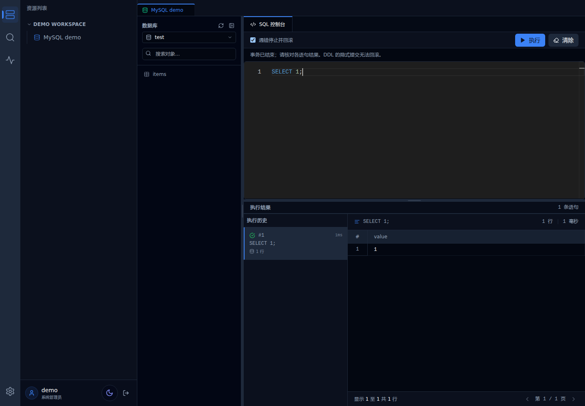

# OpsNexus

**An SSH and database workspace for internal operations teams.**

English · [简体中文](README.zh-CN.md)

OpsNexus brings SSH terminals, SFTP file management, MySQL, Dameng DM8, Redis, and MongoDB into one web interface. A Go backend embeds the React frontend, so deployment needs one executable and a YAML configuration file, with no separate application database.

Designed for trusted internal teams whose administrators share access to configured assets. The interface supports English and Simplified Chinese.



## Features

| Module | Capabilities |
| --- | --- |
| Asset workspace | Group servers and databases in YAML; switch between workspace tabs |
| SSH / SFTP | Browser terminals, terminal resizing, directory browsing, uploads, downloads, file and empty-directory operations |
| MySQL / DM8 | Database/schema browsing, paginated table previews, SQL editing and completion, batch execution, statement results and transaction status |
| Redis | SCAN browsing, String/Hash editing, TTL management, deletion, single-command console |
| MongoDB | Collection queries, aggregation pipelines, Extended JSON, document CRUD APIs, native scripts and optional mongosh |
| Login and preferences | Captcha, configured administrators, JWT sessions, idle logout, light and dark themes, English / Simplified Chinese |

Redis List/Set/ZSet views and the MongoDB collection grid are currently read-only; MongoDB writes are available through scripts or APIs. Asset configuration changes require a restart. Global search, monitoring, and workspace settings are placeholder entries.

### Interface language

Choose **English** or **简体中文** at the top right of the login page, or use the language button at the bottom of the workspace activity bar. Changes apply immediately without resetting open sessions or editor contents. The browser remembers your choice, including after signing out.

On first use, OpsNexus follows the first supported language in your browser preferences (`en-*` → English, `zh-*` → Simplified Chinese); if neither is available, it defaults to Simplified Chinese. No server configuration is required. SQL, SSH, Redis, MongoDB, TTL, JSON, and other technical names retain their standard forms. Asset names, database values, scripts, remote terminal output, and external diagnostic details are preserved. Monaco's built-in menus retain the editor's default language.

For contributors, application translations live in `web/src/i18n/zh-CN.ts` and `web/src/i18n/en.ts`. Add the same semantic key and interpolation variables to both catalogs, then use `useTranslation()` in components. Translate complete messages, including counts and pagination, rather than joining fragments. Tests check catalog consistency, language preferences, and state preservation during switching.

## Quick start

### Requirements

| Tool | Requirement |
| --- | --- |
| Go | 1.26.0 or later |
| Node.js | 22.13 or later; `nvm use` selects the project's Node 22 line |
| npm | Included with Node.js; dependencies are locked in `web/package-lock.json` |
| Make / Bash | Used by the build commands below; Windows users can use WSL or the manual commands |
| mongosh | Optional; only needed for MongoDB shell mode |

Running an already built executable does not require Go, Node.js, or npm.

### Run from source

```bash
git clone https://github.com/ebpmbp/devops-new.git opsnexus
cd opsnexus
cp config.yaml.example config.yaml
```

Edit `config.yaml`: set an administrator password and an independent `security.jwt_secret`, replace the sample assets with your own, and remove unused entries. You can generate a JWT secret with `openssl rand -hex 32`.

```bash
make all
./opsnexus --config config.yaml
```

Open **http://localhost:8080/** and sign in with your configured administrator account. Without `--config`, the server reads `config.yaml` from its working directory. Missing or invalid configuration prevents startup.

<details>
<summary>Manual build with Windows PowerShell</summary>

After cloning and editing your configuration, run these commands from the repository root:

```powershell
npm --prefix web ci
npm --prefix web run build
go build -trimpath -o opsnexus.exe ./cmd/server
.\opsnexus.exe --config config.yaml
```

</details>

## Configuration

See [config.yaml.example](config.yaml.example) for a complete example.

| Setting | Description |
| --- | --- |
| `server_address` | HTTP listen address; default `:8080` |
| `base_path` | URL prefix; default empty. A value such as `/devops` must match the frontend build prefix |
| `log_level` | Log level; default `info` |
| `security.admin_users` | At least one administrator; passwords accept plaintext or valid bcrypt hashes |
| `security.jwt_secret` | Required, nonempty signing secret |
| `security.session_timeout_minutes` | Fixed JWT lifetime and browser idle timeout, 1–1440 minutes; default 30 |
| `assets.groups` | Asset groups; server and database IDs must be globally unique |

Scalar settings can be overridden with `OPSNEXUS_` environment variables, such as `OPSNEXUS_SERVER_ADDRESS` and `OPSNEXUS_SECURITY_JWT_SECRET`. Administrator and asset lists come from YAML. SSH keys use `private_key_path`, preferably an absolute path. MongoDB accepts a URI or individual connection fields; Redis supports ACL usernames.

For subpath deployment, rebuild the frontend with the same prefix:

```bash
# Set base_path: /devops in config.yaml
VITE_BASE_PATH=/devops/ ./build.sh
```

See the [deployment guide](docs/DEPLOYMENT.md) for reverse proxies, environment overrides, operation limits, and troubleshooting.

## Build and development

| Command | Purpose |
| --- | --- |
| `make all` | Install locked frontend dependencies, build the frontend, and create `opsnexus` in the repository root |
| `make build-web` | Install frontend dependencies and build `web/dist` |
| `make build-server` | Rebuild the frontend, then build the server |
| `./build.sh` | Create Linux amd64/arm64 and Windows amd64 binaries in `dist/` |
| `make test` | Build the frontend, run Go tests, frontend lint, and component tests |
| `make vet` | Check application Go packages; known bundled DM driver findings are tracked separately |
| `make clean` | Remove generated builds and test output, preserving local configuration and installed dependencies |

For development, first run `make build-web` to generate the assets required by Go embedding. Then start two terminals:

```bash
# Terminal 1: repository root, configuration uses base_path: "" and :8080
go run ./cmd/server --config config.yaml
```

```bash
# Terminal 2: repository root
npm --prefix web run dev
```

Open the URL printed by Vite, normally `http://localhost:5173/`. API and WebSocket requests are proxied to `localhost:8080`.

## Project layout

```text
.
├── .github/             # CI, issue forms, and pull request template
├── cmd/server/          # Server entry point
├── internal/            # API, configuration, models, and services
├── pkg/                 # Shared utilities and local DM driver/adapter
├── web/
│   ├── public/          # Static assets copied without transformation
│   ├── src/             # React / TypeScript source
│   ├── tests/           # Frontend regression tests
│   └── embed.go         # Embeds the production frontend in Go
├── docs/                # Deployment, architecture, maintenance, and reviews
├── config.yaml.example  # Configuration template safe to commit
├── Makefile
└── build.sh
```

Local configuration, `.env*` files, private keys, `node_modules/`, `web/dist/`, and root build output are excluded from version control. Commit `go.sum` and `web/package-lock.json` so dependency installations remain reproducible.

## Documentation and contributing

- [Deployment](docs/DEPLOYMENT.md): configuration, Nginx, subpaths, and troubleshooting.
- [Architecture and API reference](docs/ARCHITECTURE.md) (Chinese): modules, endpoints, and operation limits.
- [Contributing](CONTRIBUTING.md): development conventions, validation, and pull requests.
- [Security reporting](SECURITY.md): private reporting and redaction guidance.
- [Documentation index](docs/README.md): release preparation, reviews, and known issues.

Issues with reproducible examples, focused feature requests, code improvements, and documentation corrections are welcome. English and Chinese contributions are welcome. Use demo assets in screenshots and remove credentials from logs.

## License

Original OpsNexus code is licensed under the [MIT License](LICENSE). Third-party code retains its own copyright and licensing terms; see [third-party notices](THIRD_PARTY_NOTICES.md). Redistribution permission for the bundled Dameng sources still needs confirmation before public distribution.
