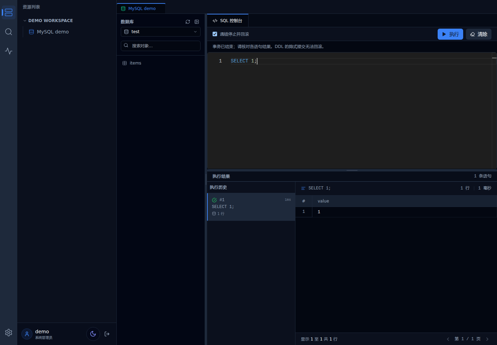

# OpsNexus

**面向内部运维团队的 SSH 与数据库工作台。**

[English](README.md) · 简体中文

OpsNexus 将 SSH 终端、SFTP 文件管理、MySQL、达梦 DM8、Redis 和 MongoDB 集中到一个 Web 界面。Go 后端内嵌 React 前端，构建后只需一个可执行文件和一份 YAML 配置，无需部署平台业务数据库。

适合管理员互信、共享资产的内部环境。界面支持简体中文和英文。



## 功能

| 模块 | 功能 |
| --- | --- |
| 资产工作区 | 按组浏览 YAML 中配置的服务器和数据库，多标签切换 |
| SSH / SFTP | Web 终端、窗口缩放、目录浏览、上传下载、新建和删除文件或空目录 |
| MySQL / DM8 | 库与模式浏览、表数据分页、SQL 编辑与补全、批量执行、逐条结果及事务状态 |
| Redis | SCAN 浏览、String/Hash 编辑、TTL 管理、删除、单命令控制台 |
| MongoDB | 集合查询、聚合管道、Extended JSON、文档 CRUD API、原生脚本及可选 mongosh |
| 登录与偏好 | 验证码、配置管理员、JWT 会话、闲置退出、明暗主题、中英文切换 |

Redis List/Set/ZSet 和 MongoDB 集合表格目前提供只读预览；MongoDB 写操作可使用脚本或 API。资产配置修改后需要重启。全局搜索、系统监控和工作区设置仍是占位入口。

### 界面语言

在登录页右上角选择 **简体中文** 或 **English**，也可使用工作区左侧活动栏底部的语言按钮切换。修改即时生效，保留已打开的会话和编辑内容；浏览器会记住选择，退出登录后仍有效。

首次访问时，OpsNexus 按浏览器偏好选择第一个支持的语言（`zh-*` 对应简体中文，`en-*` 对应英文）；均不匹配时默认使用简体中文。无需修改服务端配置。SQL、SSH、Redis、MongoDB、TTL、JSON 等技术名称保留通用写法；资产名称、数据库内容、脚本、远程终端输出和外部诊断详情均保留原文。Monaco 内置菜单沿用编辑器默认语言。

开发者可在 `web/src/i18n/zh-CN.ts` 和 `web/src/i18n/en.ts` 中维护界面文案。两份目录需使用相同的语义键和插值变量，组件通过 `useTranslation()` 使用翻译。数量、分页等内容应翻译为完整语句，避免拼接零散词语。测试覆盖翻译目录一致性、语言偏好和切换时的状态保留。

## 快速开始

### 环境要求

| 工具 | 要求 |
| --- | --- |
| Go | 1.26.0 或更新版本 |
| Node.js | 22.13 或更新版本；可用 `nvm use` 选择项目的 Node 22 版本 |
| npm | 随 Node.js 安装，依赖以 `web/package-lock.json` 锁定 |
| Make / Bash | 用于下方构建命令；Windows 可使用 WSL 或手动构建 |
| mongosh | 可选，仅 MongoDB shell 模式需要 |

运行已构建的二进制不需要 Go、Node.js 或 npm。

### 从源码运行

```bash
git clone https://github.com/ebpmbp/devops-new.git opsnexus
cd opsnexus
cp config.yaml.example config.yaml
```

编辑 `config.yaml`：设置管理员密码和独立的 `security.jwt_secret`，将示例资产替换为自己的资产，删除不需要的条目。可用 `openssl rand -hex 32` 生成 JWT 密钥。

```bash
make all
./opsnexus --config config.yaml
```

访问 **http://localhost:8080/**，使用配置的管理员账号登录。配置路径省略时读取当前工作目录的 `config.yaml`；缺失或无效配置会阻止启动。

<details>
<summary>Windows PowerShell 手动构建</summary>

完成克隆和配置编辑后，在仓库根目录执行：

```powershell
npm --prefix web ci
npm --prefix web run build
go build -trimpath -o opsnexus.exe ./cmd/server
.\opsnexus.exe --config config.yaml
```

</details>

## 配置

完整示例见 [config.yaml.example](config.yaml.example)。

| 配置项 | 说明 |
| --- | --- |
| `server_address` | HTTP 监听地址，默认 `:8080` |
| `base_path` | URL 前缀，默认空字符串；如 `/devops`，须与前端构建前缀一致 |
| `log_level` | 日志级别，默认 `info` |
| `security.admin_users` | 至少一名管理员；密码支持明文或有效 bcrypt 哈希 |
| `security.jwt_secret` | 必填，不能留空 |
| `security.session_timeout_minutes` | JWT 固定有效期和浏览器闲置超时，1–1440 分钟，默认 30 |
| `assets.groups` | 资产分组；所有服务器及数据库的 ID 必须全局唯一 |

标量可用 `OPSNEXUS_` 环境变量覆盖，例如 `OPSNEXUS_SERVER_ADDRESS` 和 `OPSNEXUS_SECURITY_JWT_SECRET`。管理员和资产列表由 YAML 提供。SSH 密钥使用 `private_key_path`，建议填写绝对路径；MongoDB 支持 URI 或独立连接字段；Redis 支持 ACL 用户名。

子路径部署须同步构建前端：

```bash
# config.yaml 中设置 base_path: /devops
VITE_BASE_PATH=/devops/ ./build.sh
```

反向代理、环境变量、数据库操作边界和常见问题见 [部署指南](docs/DEPLOYMENT.zh-CN.md)。

## 构建与开发

| 命令 | 用途 |
| --- | --- |
| `make all` | 安装锁定的前端依赖、构建前端、生成根目录 `opsnexus` |
| `make build-web` | 仅安装前端依赖并构建 `web/dist` |
| `make build-server` | 先构建前端，再生成后端二进制 |
| `./build.sh` | 在 `dist/` 生成 Linux amd64/arm64、Windows amd64 二进制 |
| `make test` | 构建前端，运行 Go 测试、前端 lint 和组件测试 |
| `make vet` | 检查应用 Go 代码；内置 DM 驱动的已知告警单独记录 |
| `make clean` | 删除构建产物及测试输出，保留本地配置和已安装依赖 |

开发时先执行 `make build-web`，为 Go 的嵌入资源生成前端文件，再分别启动两个终端：

```bash
# 终端一：仓库根目录，配置使用 base_path: "" 和 :8080
go run ./cmd/server --config config.yaml
```

```bash
# 终端二：仓库根目录
npm --prefix web run dev
```

打开 Vite 输出的地址（通常为 `http://localhost:5173/`）。API 和 WebSocket 会代理到 `localhost:8080`。

## 项目结构

```text
.
├── .github/             # CI、Issue 和 PR 模板
├── cmd/server/          # 服务启动入口
├── internal/            # API、配置、模型和业务服务
├── pkg/                 # 公共工具及本地 DM 驱动/适配层
├── web/
│   ├── public/          # 原样复制的静态资源
│   ├── src/             # React / TypeScript 源码
│   ├── tests/           # 前端回归测试
│   └── embed.go         # 将构建后的前端嵌入 Go
├── docs/                # 部署、架构、维护和审查记录
├── config.yaml.example  # 可提交的配置示例
├── Makefile
└── build.sh
```

`config.yaml`、`.env*`、私钥、`node_modules/`、`web/dist/` 和根目录构建产物不纳入版本控制。保留并提交 `go.sum`、`web/package-lock.json`，以便复现依赖安装。

## 文档与贡献

- [部署指南](docs/DEPLOYMENT.zh-CN.md)：配置、Nginx、子路径和故障排查。
- [架构与 API](docs/ARCHITECTURE.md)：模块职责、接口和操作限额。
- [贡献指南](CONTRIBUTING.md)：开发约定、验证和 Pull Request 要求。
- [安全问题报告](SECURITY.md)：私密报告渠道和脱敏要求。
- [文档索引](docs/README.md)：发布流程、审查记录和已知问题。

欢迎通过 Issue 提交可复现的问题或具体需求，也欢迎完善代码和文档。支持中文或英文交流；截图与日志请使用演示资产并去除凭证。

## 许可证

OpsNexus 自有代码采用 [MIT 许可证](LICENSE)。第三方代码保留各自版权和授权条件，详见 [第三方声明](THIRD_PARTY_NOTICES.md)；内置达梦源码的再分发许可仍需在公开发布前确认。
