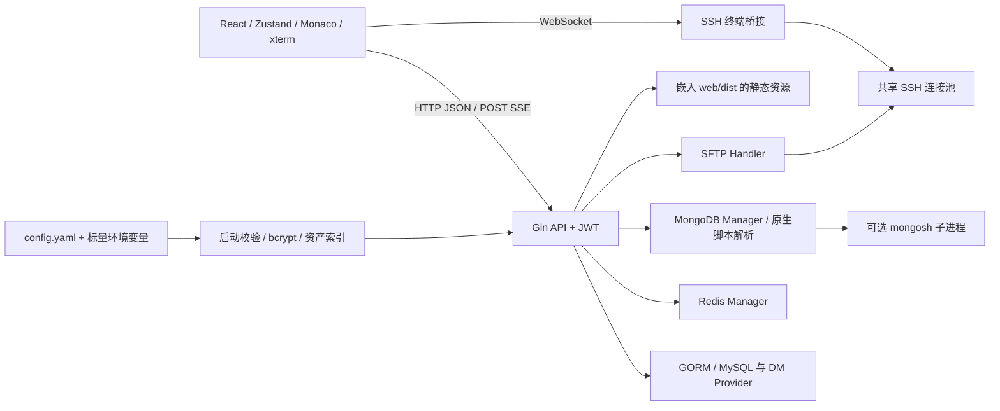

# 架构与接口说明

本文描述当前实现。使用定位为可信内部运维工具，所有配置管理员共享全部资产。

[文档索引](README.md) · [部署指南](DEPLOYMENT.zh-CN.md)

## 运行结构



| 位置 | 职责 |
| --- | --- |
| `cmd/server/main.go` | 配置加载、密码准备、资产初始化、HTTP 服务、信号退出 |
| `internal/config` | YAML/环境变量、启动参数校验、资产结构 |
| `internal/api/router.go` | 路由、CORS、访问日志、静态文件、SPA 回退 |
| `internal/api/handler` / `middleware` | 验证码登录、JWT 验证、用户名及到期时间上下文 |
| `internal/api/v1` | HTTP 参数与状态码、SSE、WebSocket/SFTP 适配 |
| `internal/service/asset` | 只读配置索引；启动时初始化，不支持热更新 |
| `internal/service/executor` | SQL 方言元数据、分句执行与事务生命周期 |
| `internal/service/metadata` | 表列元数据缓存，TTL 30 分钟，DDL 后失效 |
| `internal/service/redis` / `mongo` | 连接缓存、协议操作、预览结果转换 |
| `internal/service/ssh_service` | 同资产连接复用、建连去重、失联监控、关闭 |
| `pkg/dbutil` / `sqlutil` / `mongoutil` / `sshutil` | DSN、结果扫描、SQL 分句、BSON 转换、SSH 握手 |
| `pkg/gormdm` / `pkg/dm` | 本地 DM GORM 适配及第三方驱动源码 |
| `web/src` | 页面和模块组件、请求封装、会话/布局状态 |
| `web/embed.go` | 将前端资源打入 Go 二进制 |

无平台业务数据库、后台任务队列、持久化执行记录或服务端会话表。验证码、连接与元数据缓存仅驻留本进程；多实例之间不共享。运行时账号/资产凭证由配置传入。

## 请求和连接生命周期

- 登录：验证码通过后比较 bcrypt 密码，签发 HS256 JWT。普通 API 使用 `Authorization: Bearer …`；浏览器终端和文件下载兼容查询参数 `token`。JWT 必须有有效 `exp`，用户必须仍存在于当前配置。
- HTTP 日志仅输出方法、URL 路径、状态码和耗时，不记录查询串或请求体。数据库错误可能由底层驱动写入日志；平台没有操作审计库。
- SQL：每个请求创建并关闭独立 GORM/SQL 连接池，不复用跨请求事务状态。批量执行在一个数据库事务中依次运行，查询预览最多 1000 行。客户端取消会传给数据库上下文，流发送也会停止。
- SSH：按资产 ID 复用底层连接，终端各自创建 session，SFTP 各自创建 channel。建连用 singleflight 去重；不同资产不会因 SSH 拨号持有全局写锁而互相阻塞。每 30 秒 keepalive，10 秒无响应则移除连接。终端 stdout/stderr 串行写入二进制 WebSocket 帧，避免并发写及 UTF-8 分片损坏。退出 shell 会关闭 WebSocket；JWT 到期关闭该终端。
- Redis：按资产及解析后的逻辑库编号缓存客户端，支持 ACL 用户名。控制台每条命令使用独立客户端，避免命令改变 UI 连接状态。
- MongoDB：按资产缓存客户端，首次连接 Ping 失败会断开并释放。原生操作使用 driver，shell 模式启动本机 `mongosh`，不具备沙箱隔离。
- SIGINT/SIGTERM：HTTP 最多等待 10 秒，随后关闭 SSH、Redis、MongoDB 缓存连接。HTTP `ReadHeaderTimeout` 10 秒、`IdleTimeout` 60 秒；不配置会截断 SSE/WebSocket 的统一写超时。

## 数据正确性和限额

| 链路 | 当前行为 |
| --- | --- |
| SQL 批量执行 | 5 分钟上下文；每条查询最多返回 1000 行；不会自动重试写入 |
| SQL 表预览/元数据 | 30 秒查询上下文；预览默认 50 行，`pageSize` 1–1000、`page` 1–1000000 |
| SQL 分句 | 单/双引号、反引号、转义、注释、分号；保留 MySQL 可执行版本注释；不支持客户端 `DELIMITER` 与过程块语法 |
| SQL 事务 | `stop_on_error=true` 停止并尝试回滚；false 继续并尝试提交成功语句。DDL、显式事务控制及数据库特定行为不能被包装事务完全撤销 |
| Redis | SCAN `count` 默认 100，最大请求值 1000（协议中是提示值，不保证实际条数）；集合预览约 100 项；命令上下文 10 秒 |
| Redis TTL | 秒；`-1` 和 `0` 均持久化，正数设置过期。Hash 仅合并输入字段，避免丢掉预览之外的数据 |
| Mongo 查询 | 默认 50、最大 1000 文档；非负 skip；按输入顺序保持多字段 sort |
| Mongo 聚合 | 默认及最大输出 1000；预览可请求更少；末尾追加 `$limit`，带 `$out`/`$merge` 的写入管道应使用 mongosh |
| Mongo schema sample | 默认 100、最大 1000 |
| Mongo 原生/shell | 10 秒操作上下文；shell 输出最多 1 MiB；mongosh 版本探测最多 3 秒 |
| BSON | 官方 Extended JSON 转换；ObjectID、日期、Timestamp、Binary、Regex、Decimal128 等保留类型，int64 用 `$numberLong` 避免 JS 精度损失 |
| SFTP | Linux 远端路径用 `/`，不受后端 Windows 路径分隔符影响；新建文件使用排他创建，上传覆盖已有文件；删除目录仅限空目录 |

行数/文档数限制不是总响应字节限制。超大字符串、单个大文档、全表计数和复杂聚合仍会消耗资源。SQL 查询遇到重复列名时追加 `(n)` 保留全部值；超过 JS 安全整数范围的 int64 返回字符串。SQL 无 `ORDER BY` 的分页次序由数据库决定。分页预览的 `COUNT` 和数据查询不保证同一快照。

## API 目录

所有路径前面加配置的 `base_path`。除登录/验证码以外均须认证。参数失败通常返回 400，未认证 401，未知资产/键或路由为 404；连接/执行失败返回 500。SQL 流建立后，错误放在 SSE 数据中，不能仅依据 HTTP 200 判断成功。

| 方法 | `/api` 后的路径 | 请求要点 |
| --- | --- | --- |
| GET | `/auth/captcha` | 返回 `captcha_id`、`image` |
| POST | `/auth/login` | `username,password,captcha_id,captcha`；返回 `token,username,session_timeout_minutes` |
| GET | `/v1/assets` | 分组资产树；不包含凭证 |
| GET | `/v1/assets/:id/databases` | MySQL 库 / DM schema 列表 |
| GET | `/v1/assets/:id/tables` | query `database` |
| GET | `/v1/assets/:id/table_data` | query `database,table,page,pageSize` |
| GET | `/v1/assets/:id/metadata` | query `database`；返回 `{tables:[{n,c}]}` |
| POST | `/v1/executor/batch` | `connection_id,type,database,script,stop_on_error`；type 必须与资产一致 |
| GET / WS | `/v1/terminal/ws` | query `asset_id,token`；输入文本/字节，resize 为 `{cols,rows}`；二进制输出及 `{type:"connected"}` 文本控制帧 |
| GET | `/v1/sftp/:asset_id/list` | query `path`，默认 `/` |
| POST | `/v1/sftp/:asset_id/upload` | query `path` 默认 `/tmp`；multipart 字段 `file` |
| GET | `/v1/sftp/:asset_id/download` | query `path`，支持 `token` |
| POST | `/v1/sftp/:asset_id/mkdir`、`/create_file` | query `path` |
| DELETE | `/v1/sftp/:asset_id/delete` | query `path` |
| POST | `/v1/redis/scan` | `asset_id,pattern,cursor,count,db` |
| GET | `/v1/redis/key` | query `asset_id,key,db` |
| PUT | `/v1/redis/key` | `asset_id,key,type,value,ttl,db`；type 为 string/hash |
| DELETE | `/v1/redis/key` | `asset_id,keys,db`，keys 不得为空 |
| POST | `/v1/redis/command` | `asset_id,command,args,db`；无结果返回 `result:null` |
| GET | `/v1/mongo/databases` | query `asset_id`；返回列表和默认数据库 |
| GET | `/v1/mongo/collections` | query `asset_id,database` |
| POST | `/v1/mongo/query` | `asset_id,database,collection,filter,sort,skip,limit` |
| POST | `/v1/mongo/aggregate` | `asset_id,database,collection,pipeline,limit` |
| POST | `/v1/mongo/document` | `asset_id,database,collection,document` |
| PUT | `/v1/mongo/document` | `asset_id,database,collection,filter,update`；filter 不得为空；普通字段转 `$set`，忽略普通字段中的 `_id` |
| DELETE | `/v1/mongo/document` | `asset_id,database,collection,filter`；filter 不得为空，删除所有匹配文档 |
| GET | `/v1/mongo/schema` | query `asset_id,database,collection,sample_size` |
| POST | `/v1/mongo/script` | `asset_id,database,script,mode`；mode 为 native（默认）/shell |
| GET | `/v1/mongo/capabilities` | mongosh 可用性、路径和版本 |

Redis 的 `db` 省略时采用资产默认值；请求中明确指定时允许 0–1024，实际能否使用取决于 Redis 的配置。界面选择器目前提供 DB 0–15。MongoDB 原生脚本支持 `db.getCollectionNames()` 及集合方法 `find,findOne,aggregate,count,countDocuments,insertOne,updateOne,updateMany,deleteOne,deleteMany`；参数使用 JSON/Extended JSON，`find` 可传 projection。不支持链式调用或任意 JavaScript。

### SQL SSE

响应类型为 `text/event-stream`，事件名 `message`。每条语句返回：

```json
{"sequence":1,"statement":"SELECT 1","status":"success","rows_affected":1,"time_cost_ms":2,"columns":["1"],"data":[{"1":1}]}
```

结束时返回事务结果（`kind: "transaction"`）；例如成功提交：

```json
{"kind":"transaction","sequence":0,"statement":"COMMIT","status":"success","rows_affected":0,"time_cost_ms":0}
```

事务失败、回滚或超时返回 `status:"error"` 和 `error`。只收到语句成功事件，不能证明事务已提交。连接断开后没有最终事务结果时，界面提示结果未知，必须先核对数据库。空脚本只有注释时返回 `statement:"EMPTY"`，不会创建事务。

## 后续演进方向

先保持单体结构。最有价值的下一步是建立 MySQL/DM/MongoDB/SSH 的可重复测试资产，并补充断网、重启、大字段和长查询验收。数据量或并发上升后，再考虑请求级并发限额、按字节约束结果、元数据批量加载、连接池生命周期统一及前端按功能加载。当前不需要为可信内部使用引入微服务或角色系统。
